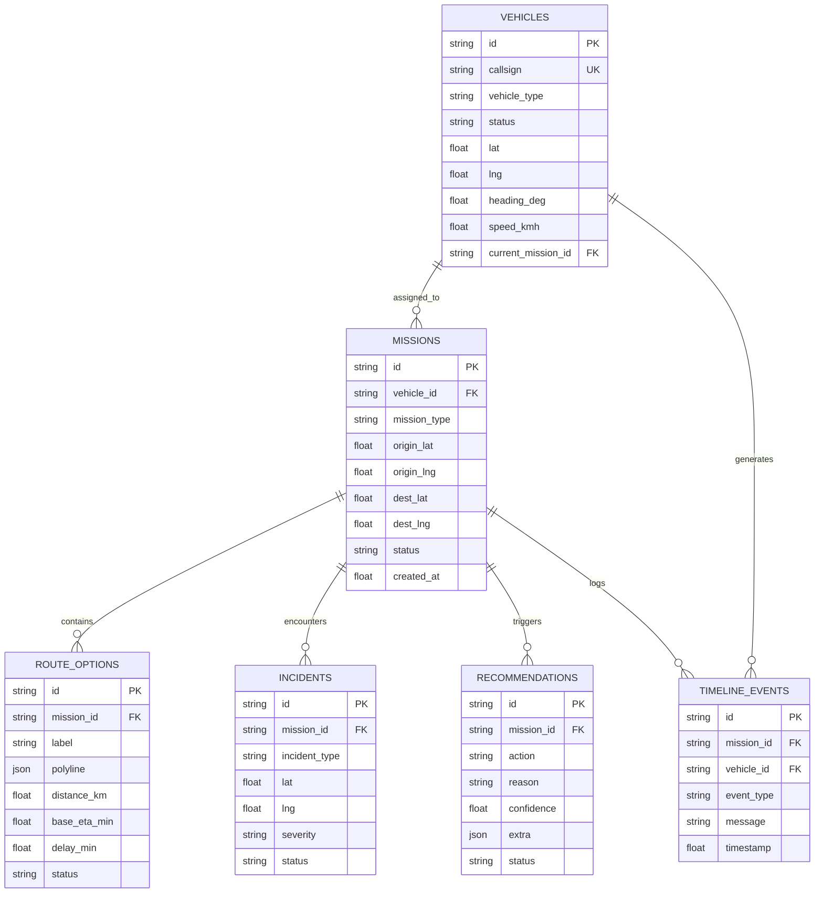

# 🚑 GeoAgentic — Emergency Fleet & Decision System

[](https://fastapi.tiangolo.com/)
[](https://osmnx.readthedocs.io/)
[](https://networkx.org/)
[](https://leafletjs.com/)
[](#)

> **GeoAgentic** is an intelligent, spatial-agentic decision engine and multi-role operations dashboard designed for urban emergency services (Ambulance, Fire & Rescue, Police). It automates real-time route optimization, debounced deviation detection, corridor blockage rerouting, and multi-factor AI dispatch reasoning for dense, high-congestion urban centers (demonstrated across Bengaluru, Karnataka, India).

---

## 📋 Table of Contents
- [Executive Overview](#-executive-overview)
- [System Architecture & Core Objectives](#-system-architecture--core-objectives)
  - [Objective A: Road Network & Arterial Routing](#objective-a-road-network--arterial-routing)
  - [Objective B: GPS Ingestion & Synthetic Telemetry](#objective-b-gps-ingestion--synthetic-telemetry)
  - [Objective C: Debounced Deviation Detection](#objective-c-debounced-deviation-detection)
  - [Objective D: Causal Incident & Corridor Simulation](#objective-d-causal-incident--corridor-simulation)
  - [Objective E: Hybrid Dual-Engine Rerouting](#objective-e-hybrid-dual-engine-rerouting)
  - [Objective F: GeoAgent AI Decision Engine (5 Questions)](#objective-f-geoagent-ai-decision-engine-5-questions)
- [Multi-Role Dashboard Interfaces](#-multi-role-dashboard-interfaces)
  - [1. Control Room (Dispatcher View)](#1-control-room-dispatcher-view)
  - [2. Driver Heads-Up Display (HUD)](#2-driver-heads-up-display-hud)
  - [3. Admin & Telemetry Dashboard](#3-admin--telemetry-dashboard)
- [Relational Data Model](#-relational-data-model)
- [REST API Reference](#-rest-api-reference)
- [Project Directory Structure](#-project-directory-structure)
- [Installation & Quickstart Guide](#-installation--quickstart-guide)
- [Test Suite & Verification](#-test-suite--verification)
- [License](#-license)

---

## 🌟 Executive Overview

In dense urban environments, emergency dispatchers face unpredictable obstacles: unmapped road closures, sudden waterlogging, accidents, and acute traffic gridlock. Standard navigation engines frequently route emergency vehicles down narrow residential cross-streets and dead ends, leading to catastrophic delays.

**GeoAgentic solves this through a closed-loop spatial intelligence pipeline:**
1. **Arterial-Biased Road Physics:** Penalizes narrow residential alleys by up to 50x, prioritizing wide arterial corridors suitable for heavy emergency vehicles.
2. **Noise-Immune Deviation Detection:** Uses perpendicular point-to-segment projection combined with multi-ping debouncing to eliminate false alarms caused by urban high-rise GPS drift.
3. **Continuous Decision Engine:** Evaluates live telemetry against five mission-critical questions, providing natural language explanations and quantifiable confidence scores.
4. **Dispatcher-in-the-Loop Workflow:** Provides clear recommendations (alternative bypass vs. backup unit dispatch from nearby hospital stations) with human-in-the-loop approval mechanisms.

---

## 📐 System Architecture & Core Objectives

```
   ┌─────────────────────────────────────────────────────────────┐
   │                  OSM Road Network Graph                     │
   │      (Bengaluru Urban Center, 9km radius, cached GraphML)    │
   └──────────────────────────────┬──────────────────────────────┘
                                  │
    ┌─────────────────────────────┼─────────────────────────────┐
    ▼                             ▼                             ▼
[Objective A]               [Objective B]                 [Objective D]
Arterial Routing            GPS Stream Synth              Incident Corridor
• Urban speed bands         • 15m densification           • Multi-edge stretch
• Signal penalty (6s/node)  • Gaussian drift (5-15m)      • Blockage barriers
• Heavy arterial bias       • Bearing / heading           • Finite 1e7 penalty
    │                             │                             │
    └─────────────────────────────┼─────────────────────────────┘
                                  ▼
                            [Objective C]
                      Deviation Detector & Session
                      • Perpendicular distance (50m)
                      • 3-consecutive-ping debounce
                      • Thread-safe trip session store
                                  │
                                  ▼
                            [Objective E]
                       Dual-Engine Rerouter
                      • Local OSMnx / NetworkX bypass
                      • Google Cloud Routes API + polyline check
                      • Automatic graceful offline fallback
                                  │
                                  ▼
                            [Objective F]
                     GeoAgent Decision Engine
        Answers 5 Core Questions with Dynamic Confidence Scoring:
        1. Has vehicle deviated?      4. What is the best bypass route?
        2. What caused deviation?     5. Dispatch backup vehicle?
        3. Expected delay?            (Confidence Score: 0.52 - 0.99)
                                  │
    ┌─────────────────────────────┴─────────────────────────────┐
    ▼                                                           ▼
[FastAPI Backend Engine]                             [Multi-Role Operations UI]
• Fleet Manager & Mission State                      • 1. Control Room (Dispatcher)
• Real-time Audit Timeline                           • 2. Driver HUD & Reporting
• Admin System Metrics                               • 3. Telemetry & Graph Admin
```

---

### Objective A: Road Network & Arterial Routing
- **Spatial Coverage:** Centered at Bengaluru urban core (`12.9250, 77.5780`) with a 9,000-meter radius, spanning Koramangala, Jayanagar, BTM Layout, JP Nagar, Banashankari, and PES University.
- **Offline Graph Caching:** First-run download from OpenStreetMap/Overpass is automatically serialized to `backend/app/data/bengaluru.graphml` (~76 MB). Subsequent boots load in seconds with zero network dependency.
- **Realistic Urban Speeds:** Replaces theoretical statutory speed limits with realistic urban speed bands:
  - Motorway: 40 km/h | Trunk: 35 km/h | Primary: 30 km/h | Secondary: 24 km/h | Residential: 14 km/h | Living street / Service: 10–12 km/h.
- **Signal Delay Modeling:** Detects real physical traffic signal nodes (`highway=traffic_signals`) and adds a 6-second delay per node (summing to an accurate 20–35s delay across multi-node divided intersections).
- **Emergency Class Penalty Matrix:** Edge travel times are scaled to strictly discourage narrow corridors:
  $$\text{Emergency Weight} = \text{Travel Time} \times \text{Class Penalty}$$
  - Primary / Trunk / Motorway: `1.0`
  - Secondary: `1.15`
  - Tertiary: `1.35`
  - Unclassified: `6.0`
  - Residential: `25.0`
  - Living Street / Service: `50.0`

### Objective B: GPS Ingestion & Synthetic Telemetry
- Emits synthetic GPS pings (`lat`, `lon`, `speed_kmh`, `heading_deg`, `timestamp`).
- **Densification:** Interpolates route nodes at 15m intervals (`_densify`) so vehicle tracking moves fluidly rather than jumping between sparse graph nodes.
- **Telemetry Realism:** Injects realistic Gaussian positional noise ($\pm 5\text{--}15\text{m}$) matching urban GPS receiver behavior.

### Objective C: Debounced Deviation Detection
- **Spatial Metric:** Calculates exact perpendicular distance from incoming coordinates to the nearest segment of the planned route polyline using equirectangular projection at city scale (`_point_to_segment_distance_m`).
- **Debounce Protection:**
  - `DEVIATION_THRESHOLD_M = 50.0` (2.5x higher than typical urban signal drift).
  - `CONSECUTIVE_PINGS_NEEDED = 3` (Requires 3 continuous off-route pings, ~6s, before confirming a deviation).
  - Isolates momentary multi-path reflection errors and GPS spikes near tall buildings from genuine path departures.
- **Thread-Safe Session Store:** In-memory, per-vehicle trip session manager (`monitoring.py`) with automatic stale-session TTL cleanup (default 15 minutes).

### Objective D: Causal Incident & Corridor Simulation
- Simulates realistic incidents along active routes:
  - `accident` (full blockage)
  - `roadwork` (full closure)
  - `road_closure` (corridor barricade)
  - `heavy_congestion` (6x delay multiplier)
- **Corridor Blocking (`block_incident_corridor`):** Rather than blocking a single geometric edge, blocks the primary edge plus downstream edges along the arterial segment for 6 steps (~300–450m). This prevents routing algorithms from cheating by cutting through narrow 50m residential alleys only to rejoin the blocked road 50 meters ahead.

### Objective E: Hybrid Dual-Engine Rerouting
- **Local In-Memory Engine:** Operates on an isolated in-memory copy of the road graph. Blocks edges using a finite barrier cost (`BLOCKED_EDGE_PENALTY = 1e7`) rather than `float('inf')` (preventing Starlette/FastAPI JSON serialization crashes while ensuring bypass discovery).
- **Google Cloud Routes API (`google_router.py`):**
  - Sends requests with `computeAlternativeRoutes: true`.
  - Decodes Google encoded polyline geometries into coordinate arrays.
  - Checks route geometries against the obstacle coordinate using Haversine distance.
  - Filters out candidates colliding with the blockage and selects the fastest clean corridor bypass.
- **Graceful Fallback:** If the Google Routes API key is unset, invalid, or quota-limited, the system seamlessly uses the local OSMnx routing engine without interruption.

### Objective F: GeoAgent AI Decision Engine (5 Questions)
The decision engine (`decision_engine.py`) synthesizes spatial graph analytics, active session telemetry, and fleet states to answer the 5 core control room questions:
1. **Has the vehicle deviated?** Verifies off-route distance and debounced confirmation state.
2. **What caused the deviation?** Identifies root cause (e.g., Road Accident, Infrastructure Blockage, Severe Congestion, or Driver Deviation).
3. **How much delay is expected?** Calculates difference between original ETA and the recomputed route ETA.
4. **What is the best alternative route?** Generates the optimal bypass corridor avoiding residential chokepoints.
5. **Should another ambulance be dispatched?**
   - Compares primary vehicle's delayed arrival time against response times of idle vehicles stationed at regional hospital depots (*St. John's Hospital, Fortis Bannerghatta, Manipal Old Airport Rd, Koramangala 108 Station*).
   - If expected delay exceeds `BACKUP_DISPATCH_DELAY_THRESHOLD_S` (3.0 minutes) AND a standby unit can reach the destination faster, recommends an immediate backup dispatch.
- **Dynamic Multi-Factor Confidence Scoring:**
  $$C_{\text{composite}} = 0.35 \cdot C_{\text{spatial}} + 0.45 \cdot C_{\text{telemetry}} + 0.20 \cdot C_{\text{decision}}$$
  - $C_{\text{spatial}}$: Graph snap precision (penalizes off-network snapping).
  - $C_{\text{telemetry}}$: Consecutive ping stability & telemetry freshness.
  - $C_{\text{decision}}$: Distance margin relative to the backup threshold.

---

## 🖥️ Multi-Role Dashboard Interfaces

The frontend (`frontend/index.html`) is a command-center interface built with Leaflet.js, dark-mode styling, and real-time interaction across three operational roles:

```
┌────────────────────────────────────────────────────────────────────────┐
│  🚑 GeoAgentic    [PROTOTYPE]    Multi-Role Emergency Operations        │
│  [🚨 1. Control Room]    [🚐 2. Driver HUD]    [⚙️ 3. Admin & System]  │
└────────────────────────────────────────────────────────────────────────┘
```

### 1. Control Room (Dispatcher View)
- **Fleet Selector:** Switch between active ambulances (`AMB-104 ALS`, `AMB-108 Critical Care`), fire engines (`FIRE-201 Heavy Water`, `FIRE-202 Rescue`), and police cruisers (`POL-301 Interceptor`, `POL-302 Rapid`).
- **Interactive Dispatch:** Enter source/destination addresses with built-in landmark autocomplete (Sony World Junction, Forum Mall, St. John's Hospital, etc.) and priority codes (*Code Red, Yellow, Blue*).
- **Real-Time Map Visualization:**
  - 🔵 **Blue Polyline:** Planned arterial dispatch route.
  - ⚫ **Dashed Black:** Simulated actual vehicle path.
  - 🔴 **Red Marker / Corridor:** Obstacle / road closure location.
  - 🟢 **Emerald Green Polyline:** Recommended dynamic bypass route.
  - 🚑 **Vehicle Marker:** Smooth animated vehicle tracking with compass heading.
- **Live Telemetry & Status HUD:** Distance remaining, initial ETA, added delay, identified cause, and off-route displacement.
- **GeoAgent Reasoning Console:** Displays structured answers to the 5 control room questions, live confidence meter, and natural language explanation.
- **Dispatcher Actions:** One-click **Approve Reroute** or **Dispatch Backup Unit** buttons to execute decisions.
- **Operational Timeline:** Real-time chronological audit trail of all dispatch milestones, deviation alerts, and driver reports.

### 2. Driver Heads-Up Display (HUD)
- **Driver Cabin Interface:** Designed for on-board vehicle touchscreens.
- **Navigation Directives:** Shows current speed, compass bearing, destination banner, remaining route distance, and ETA countdown.
- **Driver Incident Reporting:** One-touch modal for reporting real-world on-scene blockages back to the control room:
  - 🌊 Waterlogging / Flash Flood
  - 🚧 Road Construction / Barricade
  - 🚗 Severe Gridlock / Narrow Chokepoint
  - 💥 Multi-Vehicle Collision
  - ⚠️ Vehicle Breakdown / Technical Failure

### 3. Admin & Telemetry Dashboard
- **System Health:** Uptime counter, active monitoring sessions, and total missions dispatched.
- **Road Network Graph Metrics:** Bengaluru 9km bounding box coverage, node count, edge count, and active weighting model.
- **Fleet Breakdown:** Categorized breakdown of vehicles by type (Ambulance, Fire, Police) and status (*Available, En Route, Deviated, Rerouted, Standby*).
- **Administrative Utilities:**
  - **Reset System:** Instantly clears missions, purges active sessions, and returns all fleet units to base.
  - **Reload Emergency Weights:** Recomputes arterial hierarchy weights in-memory without restarting the server.

---

## 🗄️ Relational Data Model

The schema is defined in [schema.sql](file:///d:/projects/GG%2726/geoagentic/schema.sql) and is compatible with both PostgreSQL and SQLite:



The backend persists all six entities in this model: vehicles, missions,
route options, incidents, recommendations, and timeline events. SQLite is the
default database at `backend/geoagentic.db`; tables and the initial fleet are
created automatically. Set `DATABASE_URL` in `backend/.env` to use a different
SQLAlchemy-supported database. Live GPS monitoring sessions remain in memory;
vehicle positions, mission state, and operational audit events are persisted.

---

## 🔌 REST API Reference

The backend exposes a high-performance REST API on port `8000`:

| Method | Endpoint | Description | Request Body Highlights |
|---|---|---|---|
| `POST` | `/api/route` | Plans arterial route, synthesizes GPS stream, registers mission | `source`, `destination`, `vehicle_id`, `priority` |
| `POST` | `/api/reroute` | Computes dynamic bypass around blocked road segment | `current_lat`, `current_lon`, `destination_lat`, `destination_lon`, `blocked_edge` |
| `POST` | `/api/trip/start` | Initializes a live GPS monitoring session | `vehicle_id`, `planned_route_coords`, `destination_lat`, `destination_lon` |
| `POST` | `/api/trip/ping` | Ingests GPS ping, computes debounced deviation & updates vehicle position | `vehicle_id`, `lat`, `lon` |
| `GET` | `/api/trip/alerts` | Queries active and past deviation alerts | Optional query param: `?vehicle_id=AMB-104` |
| `POST` | `/api/trip/end` | Concludes active trip session and marks vehicle Available | `vehicle_id` |
| `POST` | `/api/agent/recommend` | Runs GeoAgent Decision Engine (answers 5 questions + confidence score) | `vehicle_id`, `current_lat`, `current_lon`, `destination_lat`, `destination_lon`, `blocked_edge` |
| `GET` | `/api/fleet` | Returns the entire multi-vehicle fleet status registry | *None* |
| `GET` | `/api/missions` | Lists all active and past missions | *None* |
| `GET` | `/api/missions/active/{vehicle_id}` | Returns active mission details for Driver HUD | *URL parameter: vehicle_id* |
| `POST` | `/api/missions/decision` | Dispatcher workflow: approves or rejects reroute / backup dispatch | `mission_id`, `decision` ("approve"/"reject"), `action_type`, `new_route_coords` |
| `POST` | `/api/driver/report` | Driver HUD: submits an on-scene road blockage report | `vehicle_id`, `reason`, `details`, `lat`, `lon` |
| `GET` | `/api/timeline` | Returns the operational audit timeline | *None* |
| `GET` | `/api/admin/overview` | Returns system telemetry, graph stats, and fleet metrics | *None* |
| `POST` | `/api/system/reset` | Resets fleet, purges active sessions, resets missions | *None* |
| `POST` | `/api/system/reload_weights` | Recomputes road hierarchy emergency weights in-memory | *None* |
| `GET` | `/api/health` | Healthcheck and road network status | *None* |

---

## 📂 Project Directory Structure

```text
geoagentic/
├── README.md                      # Comprehensive project documentation
├── requirements.txt               # Top-level dependency reference
├── schema.sql                     # Portable PostgreSQL / SQLite schema
│
├── backend/
│   ├── .env                       # Local environment variables (Google Routes key, DB)
│   ├── .env.example               # Template environment configuration
│   ├── requirements.txt           # Backend Python dependencies
│   │
│   └── app/
│       ├── __init__.py
│       ├── api.py                 # FastAPI application, routing, multi-role endpoints
│       ├── db.py                  # SQLAlchemy models, database engine and schema initialization
│       ├── decision_engine.py     # GeoAgent AI Engine: 5 questions & confidence scoring
│       ├── detector.py            # Point-to-segment distance & debouncing logic
│       ├── dispatch.py            # Geocoding, landmark stations, dispatch planning
│       ├── fleet_manager.py       # Multi-vehicle fleet, active missions & timeline store
│       ├── google_router.py       # Google Routes API client & spatial obstacle filter
│       ├── graph_utils.py         # OSMnx graph loader, urban speeds, emergency weights
│       ├── incident_simulator.py  # Causal road corridor closures & incident injection
│       ├── main.py                # Standalone demo trip simulation script
│       ├── monitoring.py          # Real-time multi-vehicle session monitor & alert manager
│       ├── reroute.py             # Corridor-aware graph rerouting around blockages
│       ├── simulator.py           # GPS stream synthesis, noise injection & densification
│       ├── visualize.py           # Standalone Folium HTML map generator
│       │
│       ├── data/
│       │   └── bengaluru.graphml  # Pre-cached Bengaluru road network (~76 MB)
│       │
│       ├── output/                # Generated maps and artifacts
│       │
│       ├── test_decision_engine.py# Decision engine verification test
│       ├── test_edge_cases.py     # Degenerate input & disconnected network tests
│       ├── test_monitoring.py     # Thread safety & session TTL tests
│       └── test_routing.py        # Graph loading, routing & incident tests
│
└── frontend/
    ├── index.html                 # Single-page multi-role operations dashboard
    ├── package.json               # Frontend dependencies & Vite tooling
    └── vite.config.js             # Vite configuration
```

---

## 🚀 Installation & Quickstart Guide

### Prerequisites
- **Python:** 3.10, 3.11, or 3.12
- **Node.js:** 18+ (optional, required only if using Vite dev server)
- **Google Cloud Routes API Key:** (Optional; system works completely offline using the cached OSMnx graph if omitted)

---

### Step 1: Clone & Configure Backend

```bash
# Navigate to the backend directory
cd backend

# Create and activate a Python virtual environment
python -m venv .venv

# On Windows (PowerShell):
.venv\Scripts\Activate.ps1
# On Linux / macOS:
source .venv/bin/activate

# Install all backend dependencies
pip install -r requirements.txt
```

### Step 2: Set Environment Variables

Copy `.env.example` to `.env`:
```bash
cp .env.example .env
```

The default database is persistent SQLite at `backend/geoagentic.db`; no
database server setup is needed. To change it, set `DATABASE_URL` in
`backend/.env` to a SQLAlchemy URL (and install that database's Python driver).

*(Optional)* If you wish to use the Google Cloud Routes API for hybrid routing, edit `.env`:
```env
ROUTE_API_KEY=AIzaSyYourActualGoogleRoutesApiKey
```

---

### Step 3: Start the Backend Server

```bash
# Run FastAPI with Uvicorn from the backend directory
uvicorn app.api:app --reload --port 8000
```
> The road network graph is loaded directly from `backend/app/data/bengaluru.graphml`. Once ready, the terminal will log:
> `[api] Graph ready.`

Interactive OpenAPI documentation is available at [http://localhost:8000/docs](http://localhost:8000/docs).

---

### Step 4: Launch the Multi-Role Operations Frontend

You can run the frontend using either method below:

#### Method A: Using Vite (Recommended)
```bash
cd frontend
npm install
npm run dev
```
Open the local URL displayed in the terminal (typically [http://localhost:5173](http://localhost:5173)).

#### Method B: Direct Browser Launch
Since `frontend/index.html` is self-contained with CDN assets, you can also open `frontend/index.html` directly in any modern web browser or serve it via Python:
```bash
cd frontend
python -m http.server 3000
```
Navigate to [http://localhost:3000](http://localhost:3000).

---

## 🧪 Test Suite & Verification

The test suite validates graph calculations, edge cases, thread safety, and AI reasoning. Run any test from the `backend/app` directory:

### 1. Test Decision Engine
Validates normal routing, obstacle identification, delay evaluation, backup dispatch decisions, and confidence scoring:
```bash
python app/test_decision_engine.py
```

### 2. Test Edge Cases
Validates coordinate-segment inputs, identical-point degenerate edges, and disconnected graph scenarios:
```bash
python app/test_edge_cases.py
```

### 3. Test Thread Safety & TTL Cleanup
Validates concurrent multi-threaded GPS ping processing and automatic session purging:
```bash
python app/test_monitoring.py
```

### 4. Test Routing & Incidents
Validates road network loading, arterial travel times, edge rerouting, and corridor incidents:
```bash
python app/test_routing.py
```

---

## 📄 License

This project is licensed under the MIT License. See [LICENSE](LICENSE) for details.
